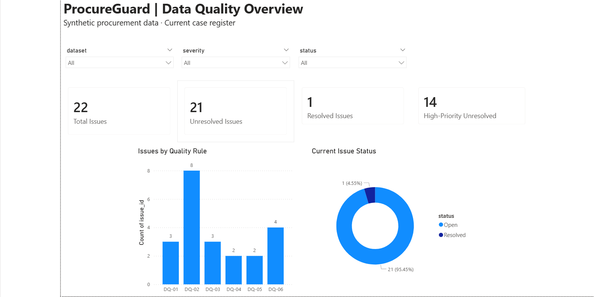

# ProcureGuard | Procurement Data Quality and Governance

Procurement teams need a reliable way to identify data exceptions, assign responsibility and verify that corrective actions worked before closing issues. ProcureGuard demonstrates this workflow using fictional procurement data.

## Results

| Metric | Initial scan | Second scan |
|---|---:|---:|
| Detected issues | 22 | 21 |
| Row-level pass rate | 42.11% | 44.74% |

One case was resolved after a failed verification and a successful fresh check of the corrected source. The remaining register contains 21 unresolved cases, including 14 high-priority issues.

**Recommended action:** Prioritize high-severity exceptions, assign owners and require source-data verification before closing cases.

## Power BI report

[Issue management](Dashboards/Screenshots/02_issue_management.png) | [Quality trends](Dashboards/Screenshots/03_quality_trends.png) | [Download report](Dashboards/ProcureGuard_Dashboard.pbix)

## Approach

I built a Python rule engine covering missing or duplicate identifiers, broken references, possible duplicate suppliers, questionable contract values and invalid date or currency formats. SQLite stores stable row IDs, ownership, investigations, corrective actions and audit events. Seven SQL views feed the three-page Power BI report.

[Operating procedure](docs/issue_management_sop.md) | [Reporting definitions](docs/reporting_layer.md) | [SQL views](sql/reporting_views.sql) | [Dashboard design](docs/powerbi_dashboard.md) | [Data dictionary](docs/data_dictionary.md)

## Reproduce

Install with `python -m pip install -e .`. Run the demonstration with `python scripts/demo_lifecycle.py --output build/lifecycle_demo` and tests with `python -m unittest discover -s tests -v`. The operating procedure covers case management and verification.

All data are fictional. The two scans demonstrate the control design and evidence-backed closure, not a production deployment or a sustained improvement in organizational performance.
